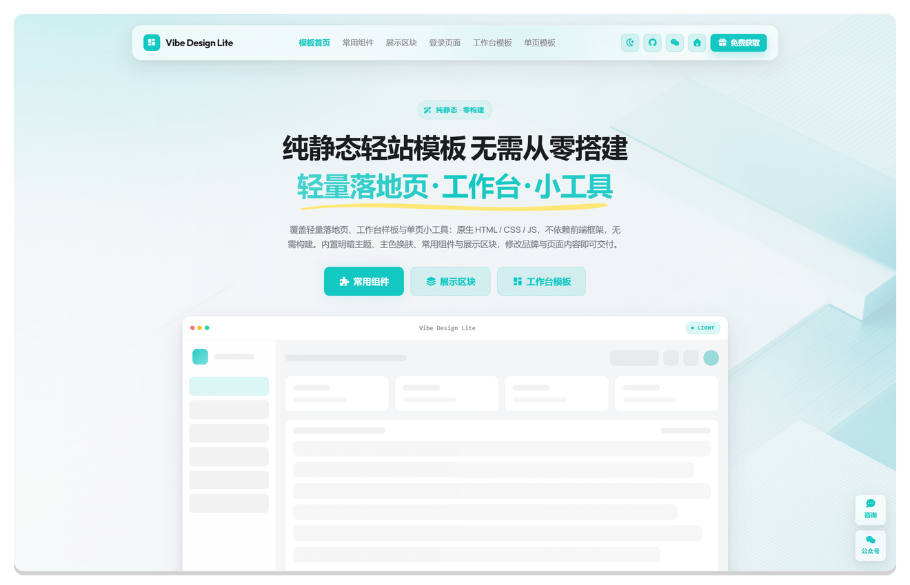
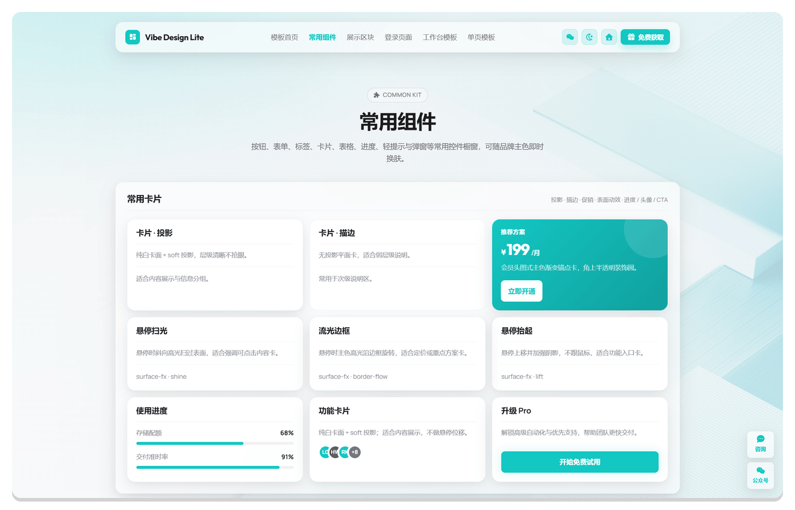
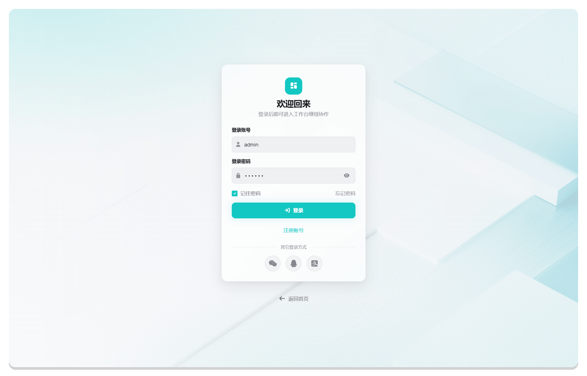
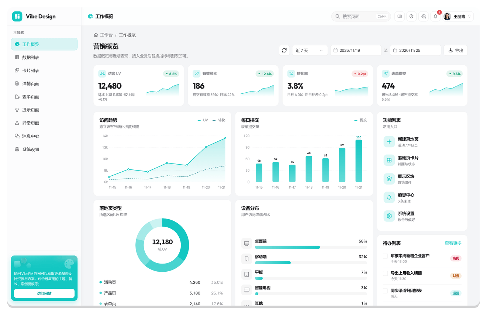
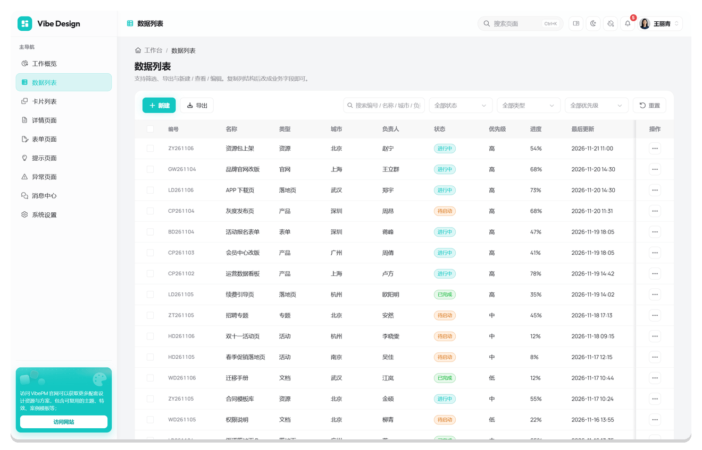
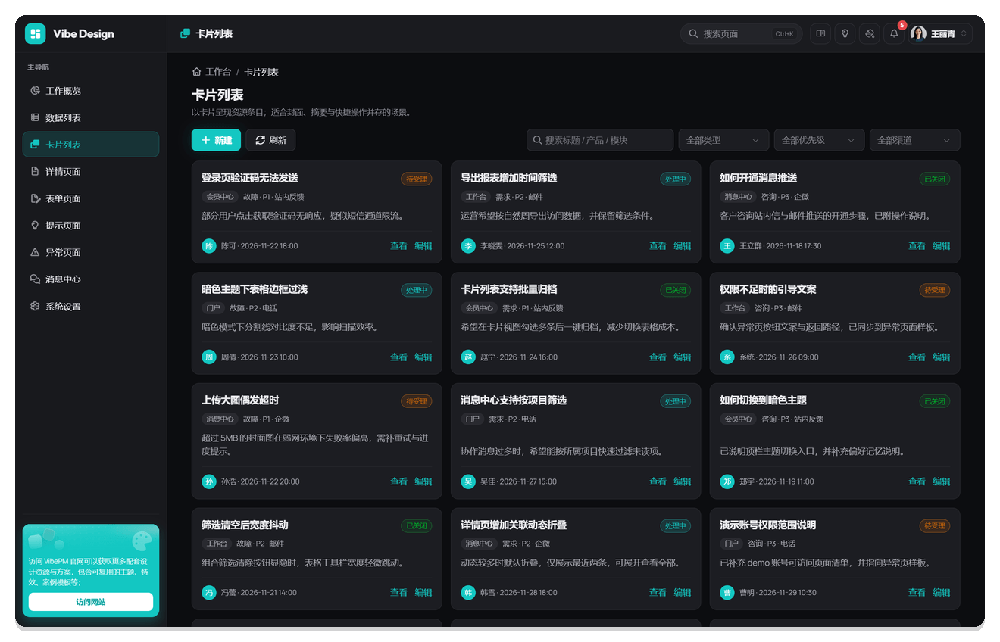
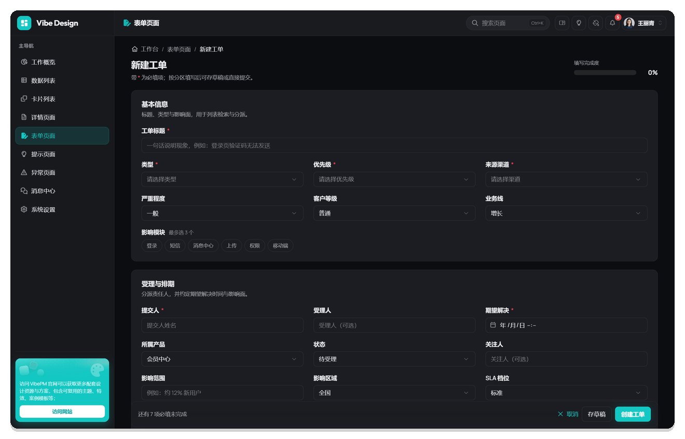

# Vibe Design Lite

开源、可复制的**轻量静态站模板**：纯 HTML / CSS / 原生 JS，不依赖前端框架，无需构建。克隆或解压后用本地静态服务打开根目录，或直接打开 `index.html` 即可预览。

适合产品落地页、轻量工作台、活动专题与单文件小工具起点；文件结构与目录分层清晰、代码与视觉规范统一，包含了各类常用组件及元素，并支持按需调用，便于用 Agent 快速改品牌与页面。

**上手后可以**

- 复制整目录 → 改品牌与主色 → 删掉不需要的示范页
- 对照 `components.html`、`showcase.html` 拷贝控件与区块
- 用 `login.html` + `shell-*.html` 搭多页静态工作台示意
- 单独拷走 `tool.html` 改造成不依赖本目录 `assets` 的内联小工具

| 链接 | |
| --- | --- |
| 在线演示 | <https://www.vibepm.net/vibedesign/lite/> |
| 完整说明（中文） | [`说明文档.md`](./说明文档.md) · 含 §4.1 Agent 提示词全文与更细约定 |
| VibePM 官网| <https://www.vibepm.net/> |

---

## 预览截图

> 圆角与阴影已烘焙进 PNG（GitHub README 会剥离 `` 的 `style`）。换图后在本机运行：`python scripts/frame-screenshots.py`（请用未处理的原图，勿重复叠加）。

**落地首页** · `index.html`

<p align="center"></p>

**常用组件** · `components.html`

<p align="center"></p>

**登录页** · `login.html`

<p align="center"></p>

**工作台概览** · `shell-dashboard.html`（亮色）

<p align="center"></p>

**数据列表** · `shell-data.html`（亮色）

<p align="center"></p>

**卡片列表** · `shell-cards.html`（暗色）

<p align="center"></p>

**表单页面** · `shell-form.html`（暗色）

<p align="center"></p>

---

## 模板里有什么

| 能力 | 说明 |
| --- | --- |
| 营销落地 | `index.html`，及可选橱窗、展示页 |
| 登录壳 | `login.html`（无营销顶栏） |
| 工作台 | 多页 `shell-*.html`；侧栏 / 顶栏 JS 注入，页内只写业务区 |
| 小工具 | `tool.html`：样式与脚本内联，一页拷走即可改 |
| 主题 | 亮 / 暗 token，`theme.js` 记忆偏好 |
| 控件 | `wa-*` + 按需 `WA_*`（弹窗、表单、上传、表格等） |
| 图标 | Font Awesome **Free 7**；一般页本地 vendor，`tool.html` **始终 CDN** |

**改站时请遵守**

1. 资源自洽：一般页用相对路径，本目录内闭环  
2. 页面同级：业务页与 `index.html` 同级，勿建 `pricing/index.html`  
3. 先删后写：不需要的示范页直接删，勿留空壳文案  
4. 按层修改：token / 壳 / 控件库 / 页级样式分开动  

---

## 快速开始

1. 克隆本仓库，或用静态服务打开仓库根目录。  
2. 打开 `index.html` 预览（推荐本地静态服务器；`file://` 亦可用）。  
3. **整目录复制**到新文件夹（英文短名如 `mysite/`），勿长期直接改模板根目录。  
4. 在 `assets/common/js/theme.js` 改成本站专属的明暗与主色存储键：

```js
var MODE_KEY = "<slug>-theme-mode";
var COLOR_KEY = "<slug>-theme-color";
```

5. 全局替换品牌名、`<title>`、meta，再按下文调主色与各分区。改完后对照文末自检清单；细节见 [`说明文档.md`](./说明文档.md)。

---

## 页面一览

| 文件 | 用途 | 何时保留 |
| --- | --- | --- |
| `index.html` | 落地首页 | 默认保留 |
| `components.html` | 常用组件橱窗 | 对照控件时 |
| `showcase.html` | 展示 / 营销区块 | 拷贝区块时 |
| `login.html` | 登录页 | 需要登录或 Lite 后台时 |
| `shell-*.html` | 工作台样板 | 需要侧栏工作台时 |
| `tool.html` | 单页内联小工具 | 整页拷走时 |

默认主导航六项：**介绍首页 → 常用组件 → 展示区块 → 登录 → 工作台 → 单页**（后三项常新窗口打开）。增删页面后请同步 `index.html`、`components.html`、`showcase.html` 的顶栏与抽屉。

- **工作台**：改 `js/shell.js` 的 `SHELL_CONFIG.nav`；页内只写 `[data-shell-content]`，壳由 `app-shell.js` 注入。  
- **`tool.html`**：FA 固定 jsDelivr Free；字体用 Google Fonts，**勿**改成本地 vendor。

---

## 目录分层（摘要）

```text
./
├── *.html                    # 页面入口（同级，禁止子目录页）
├── 说明文档.md               # 完整中文说明
├── css/ | js/                # 页级样式与脚本（本模板默认根目录）
├── assets/common/            # global · chrome · components + theme / WA_*
├── assets/fonts|images|…     # 字体、配图、特效
└── vendor/fontawesome_free/  # 一般页的 FA Free
```

| 层 | 路径 | 改动影响 |
| --- | --- | --- |
| 页面 | 根 `*.html` |  mostly 当前页 |
| 页级 | `css/`、`js/` 或 `assets/css|js/` | 同名页；`shared.*` 影响引用它的营销页 |
| 全站 | `assets/common/` | 几乎所有页面 |
| 第三方 | `vendor/` | 图标与离线依赖 |

**改什么、去哪改（速查）**

| 想改… | 文件 |
| --- | --- |
| 主色、亮暗面色 | `assets/common/css/global.css`（含亮暗 `primary-rgb`） |
| 顶栏、按钮、页脚 | `assets/common/css/chrome.css` |
| 弹窗、表单、FAQ、Toast | `assets/common/css/components.css` + 对应 `WA_*` |
| 工作台导航 | `js/shell.js` → `SHELL_CONFIG` |
| 明暗记忆 | `theme.js` 的 `MODE_KEY`、`COLOR_KEY` |

### Font Awesome（Free）

| 页面 | 引用 |
| --- | --- |
| 一般页 | `./vendor/fontawesome_free/css/all.min.css` |
| `tool.html` | `https://cdn.jsdelivr.net/npm/@fortawesome/fontawesome-free@7.3.1/css/all.min.css` |

可用：`fa-solid`、`fa-regular`、`fa-brands`。勿用 `fa-light` / `fa-thin` 等 Pro 样式（会空白）。

---

## 常见修改

- **品牌**：替换品牌名、title、meta、Hero；导航文案长度接近原版。  
- **主色**：改 `global.css` 中 `--wa-color-primary*`（亮暗各一套）；换站后更新 `COLOR_KEY`。  
- **首页分区**：按 `id` 删改 `section`，同步顶栏锚点（如 `features`、`kit`、`faq`、`cta`）。  
- **新页面**：与 `index.html` 同级新增 `pricing.html` 等，勿用子目录 `index.html`。

### Agent 提示词示例（节选）

用 Cursor 等打开本目录后，可先阅读 [`说明文档.md`](./说明文档.md)，再参考下表（**完整表见 §4.1**）：

| 场景 | 示例提示词 |
| --- | --- |
| 起步 | 请先阅读说明文档.md；我想做 XX 产品落地页，把品牌名、主色和首页文案改成我们的，其它示范页先保留。 |
| 工作台 | 请先阅读说明文档.md；我想做 XX 运营后台，从 shell-dashboard 改品牌与侧栏菜单，其它 shell 示范页先保留。 |
| 风格 | 把品牌主色改成 #2563EB，亮暗 token 一起同步 |
| 精简 | 删除登录页、工作台与单页模板，并去掉对应导航 |

首页 FAQ 区「提示词示例参考」弹窗与 [`说明文档.md`](./说明文档.md) §4.1 对齐。

---

## 精简成更轻的站

**最小组合**：`index.html` + `global.css` + `chrome.css` + `theme.js` + `css/index.css` + `js/shared.js` + `vendor/fontawesome_free`（有图标时）。有表单 / 弹窗再加 `components.css` 与 `WA_*`。先删用不到的示范页与导航入口，再写文案。

---

## 设计 token 速查

| Token | 含义 |
| --- | --- |
| `--wa-color-primary` / `primary-rgb` | 品牌主色 |
| `--wa-color-bg` / `surface` / `glass` | 页面底 / 卡片 / 玻璃面板 |
| `--wa-color-text` / `muted` | 正文 / 次要文字 |
| `--wa-shadow-card` / `--wa-radius` | 卡片阴影 / 圆角 |

按钮族：`wa-btn--primary`、`soft`、`outline`、`secondary`（见 `chrome.css`）。

---

## 自检清单

- [ ] `MODE_KEY`、`COLOR_KEY` 已改为本站专用  
- [ ] 明暗切换正常，刷新不闪错主色  
- [ ] 删页后导航无死链  
- [ ] 一般页 FA 为 `./vendor/fontawesome_free/...`，仅用 solid / regular / brands  
- [ ] `tool.html` 仍为 jsDelivr Free（未误改本地 vendor）  
- [ ] 无 `fa-light` 等导致图标空白  
- [ ] 未用到的 `WA_*` 未全挂  
- [ ] 移动端抽屉、首屏 CTA、FAQ 可点  

---

## 许可

- 模板源码：[MIT](./LICENSE)  
- 图标：[Font Awesome Free](https://fontawesome.com/license/free)（随 `vendor/fontawesome_free/` 分发）